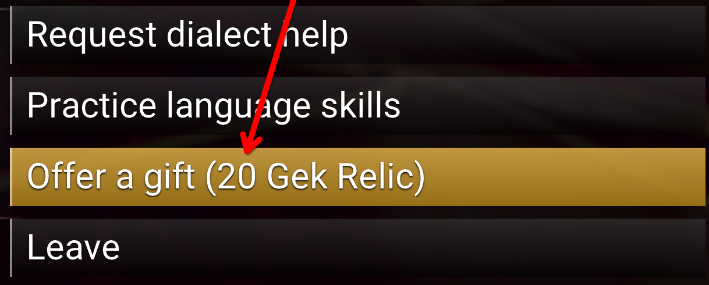
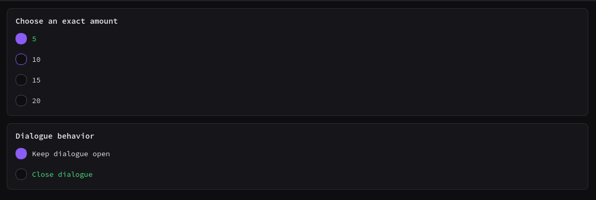

# Generous Giver

---

Mod for No Man's Sky that allows players to offer a configurable amount of alien
gifts in one interaction, while also allowing the user to choose if they want
the dialogue screen with the alien to stay open. Autophage have separate
controls for applying the multiplier and for keeping and cycling their gift
option.

---

  <kbd>
    
  </kbd>

## Downloading

The only places this mod should be downloaded from are:

- [Nexus Mods](https://www.nexusmods.com/nomanssky/mods/4774)
- [GitHub release page](https://github.com/scottdraper8/generous-giver/releases)

> [!WARNING]
>
> Official downloads are available only from Nexus Mods and GitHub Releases.
> Please report copies found elsewhere so their license compliance can be
> reviewed.

## Installing

Install the archive with [Vortex](https://www.nexusmods.com/vortex) or
[Amethyst Mod Manager](https://github.com/ChrisDKN/Amethyst-Mod-Manager). Choose
a gift amount and dialogue behavior for Gek, Korvax, and Vy'keen on the first
FOMOD page. The second page controls whether the multiplier applies to Autophage
and whether their gift option stays available and cycles to a new gift. The
recommended defaults enable the Autophage multiplier and keep and cycle their
gift option.

Each GitHub release includes the all-in-one FOMOD installer and eight optional
archives for installing without a mod manager. Choose exactly one optional
archive for the gift amount and dialogue behavior you want. All eight manual
archives enable the Autophage multiplier. Dialogue Open archives also keep and
cycle the Autophage gift option; Dialogue Closed archives close it and remove
the ability to regift that NPC.

To install an optional archive manually, extract it into the game's
`GAMEDATA/MODS` directory. The archive contains a folder named
`Generous-Giver-<quantity>-Dialogue-<Open-or-Closed>` with the mod files inside.
Do not install an optional archive alongside the FOMOD version.

  <kbd>
    
  </kbd>

---

> [!NOTE]
>
> This mod modifies the following files:
>
> - `METADATA/REALITY/TABLES/COSTTABLE.EXML`
> - `METADATA/REALITY/TABLES/REWARDTABLE.EXML`
> - `METADATA/REALITY/TABLES/NMS_DIALOG_GCALIENPUZZLETABLE.EXML`
